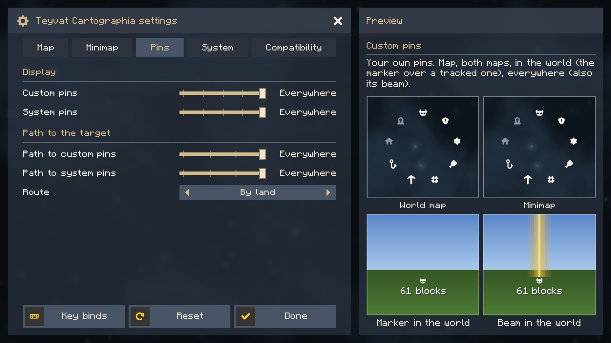
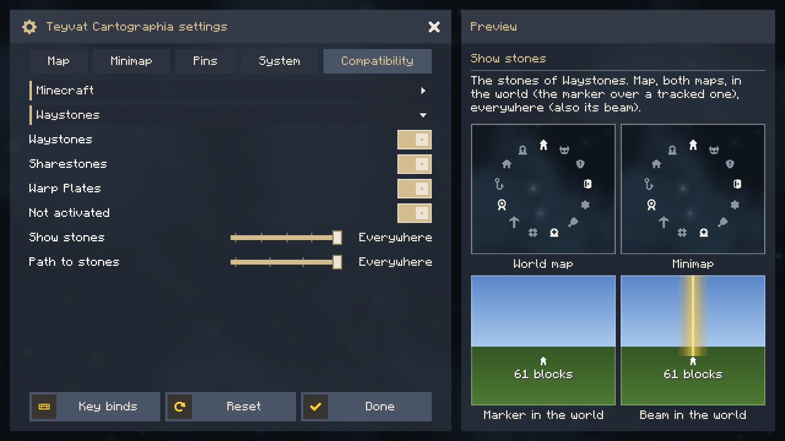
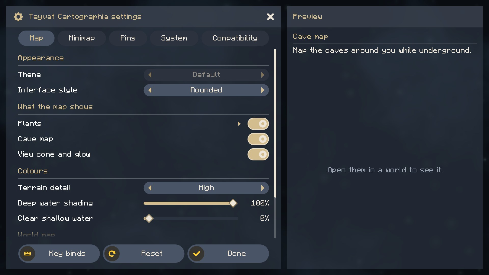
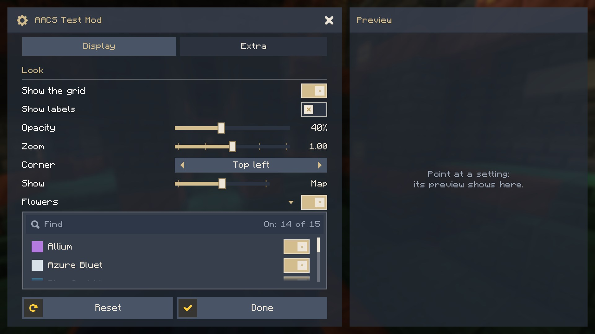
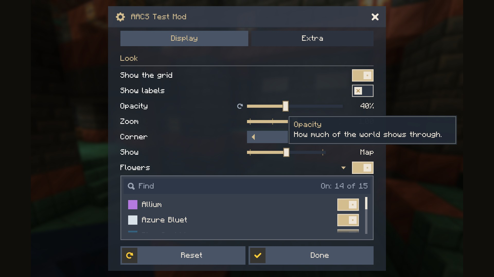

<p align="center">
  
</p>

<h1 align="center">Actually Amazing Config Screen</h1>

<p align="center">
  <a href="https://modrinth.com/mod/actually-amazing-config-screen"></a>
  <a href="https://www.curseforge.com/minecraft/mc-mods/actually-amazing-config-screen"></a>
  <a href="https://github.com/Tapacywka/actually-amazing-config-screen/releases"></a>
  
  <a href="https://github.com/Tapacywka/actually-amazing-config-screen/blob/main/LICENSE"></a>
</p>

<p align="center">
  <b>A settings screen library for Minecraft mods on Fabric and NeoForge.</b><br>
  Tabs, sections that fold, smooth scrolling, and a card beside the list that explains the setting under the pointer
  with a picture of what it does.
</p>

<p align="center">
  <a href="https://modrinth.com/mod/actually-amazing-config-screen"></a>
  <a href="https://www.curseforge.com/minecraft/mc-mods/actually-amazing-config-screen"></a>
  <a href="https://github.com/Tapacywka/actually-amazing-config-screen/releases"></a><br>
  <a href="https://fabricmc.net"></a>
  <a href="https://neoforged.net"></a>
</p>

<p align="center">
  
</p>

## For players

**You do not need to install anything.** The library comes inside the mods that use it, such as
[Teyvat Cartographia](https://github.com/Tapacywka/teyvat-cartographia). It shows in the mod list as a library, and the
settings button of each such mod opens its screen.

## What the screen does

* **Tabs** as wide as their titles, **sections**, and **sub-sections that fold**.
* **Smooth scrolling** without steps: the wheel moves a row's distance, the scroll bar can be dragged freely, and rows
  cut by the edges of the list dissolve.
* **The card beside the list**: the name and description of the setting under the pointer, and a picture of what it
  does, drawn by the mod. In a window too narrow for the card, the description shows as a tooltip by the row.
* **Rows**: switches, sliders of numbers (with a unit, fixed steps or words), choices in steps on a slider, choices
  with arrows, and a switch with a searchable list of switches under it.
* **A reset icon** beside a setting you changed, and **Reset** and **Done** at the bottom.
* **Rectangular or rounded** shapes, the mod's own colours and background, and the GUI scale held at a size that fits
  the window while the screen is open.
* **The settings button** in Mod Menu and in the mod list of NeoForge.
* **Sub-sections from other mods**: a mod can open a tab to others, and they add their own settings there.

<p align="center">
  
  
</p>
<p align="center">
  
  
</p>

## For mod authors

> **Note**
> Early development: the API in `net.tapacywka.aacs.api` may still grow and change before 1.0.0. Older methods are
> kept working (marked `@Deprecated`) rather than removed, because the loader keeps only the newest copy of the library
> among all the mods that embed it. `Aacs.API_VERSION` tells which version is running.

Embed the library in your JAR (Fabric `include`, NeoForge `jarJar`), so players have nothing to install. The files are
on [Modrinth Maven](https://support.modrinth.com/en/articles/8801191-modrinth-maven):

```groovy
repositories {
    maven { url = 'https://api.modrinth.com/maven' }
}

dependencies {
    // Fabric (Loom)
    modImplementation 'maven.modrinth:actually-amazing-config-screen:0.1.0-beta.1+mc1.21.1-fabric'
    include 'maven.modrinth:actually-amazing-config-screen:0.1.0-beta.1+mc1.21.1-fabric'
    // NeoForge (ModDevGradle)
    jarJar(implementation('maven.modrinth:actually-amazing-config-screen:0.1.0-beta.1+mc1.21.1-neoforge'))
}
```

The settings are values in a JSON file of your mod, described by a builder; the screen is laid out over them:

```java
ConfigFile.Builder b = ConfigFile.builder();
b.push("map");                                              // a section of the file: { "map": { ... } }
BoolValue grid = b.bool("grid", true);
IntValue opacity = b.integer("opacity", 80, 0, 100);
b.pop();
ConfigFile file = b.build();
file.load(configDir.resolve("mymod-client.json"));

AacsScreen screen = AacsScreen.builder("mymod", file)
        .tab("mymod.config.tab.display", t -> t
                .section("mymod.config.section.look")
                .toggle(grid)
                .slider(opacity, s -> s.unit("%"))
                .preview((g, row, x, y, w, h, partialTick) -> { /* draw a picture of the setting */ }))
        .build();                                           // also the settings button in the mod lists

boolean showGrid = grid.get();                              // read where you need it; changes count at once
Minecraft.getInstance().setScreen(screen.open(parent));
```

Texts come from your lang files: a row's name `mymod.config.<key>` and its description `mymod.config.<key>.tooltip`.

Another mod can add a sub-section to a tab you opened to others:

```java
.tab("mymod.config.tab.compat", t -> t.openTo("compatibility"))  // in your screen

AacsScreen.extend("mymod", "compatibility", "othermod", otherFile, t -> t.toggle(otherValue))  // in the other mod
        .shownIf(() -> isOtherThingLoaded);
```

## Compatibility

* Minecraft 1.21.1, Fabric (Fabric Loader 0.16 or newer, no Fabric API needed) and NeoForge 21.1.
* The Fabric file also runs on NeoForge through Sinytra Connector.
* Minecraft 26.1.2, 26.2 and 26.3: planned.

## Building

`./gradlew build` builds both JARs (`fabric/build/libs`, `neoforge/build/libs`) and runs the unit tests;
`./gradlew publishToMavenLocal` puts `net.tapacywka.aacs:aacs-common`, `aacs-fabric` and `aacs-neoforge` in the local
Maven repository. `./gradlew :fabric:runClient` and `:neoforge:runClient` open a game with a small test mod that shows
every kind of row.

## License

[MIT](https://github.com/Tapacywka/actually-amazing-config-screen/blob/main/LICENSE). The icons are from Nieobie's Game Icon Pack (CC0).
