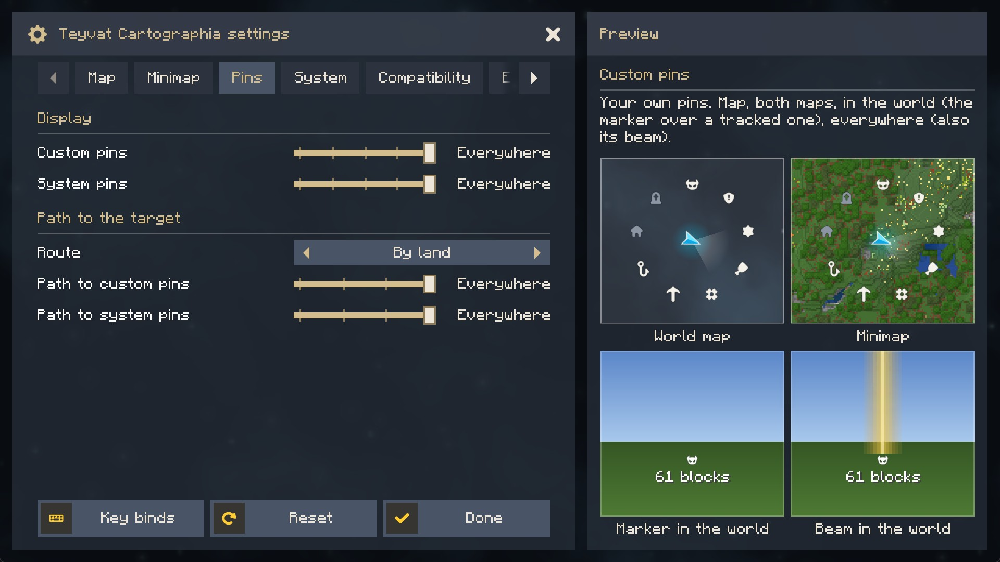
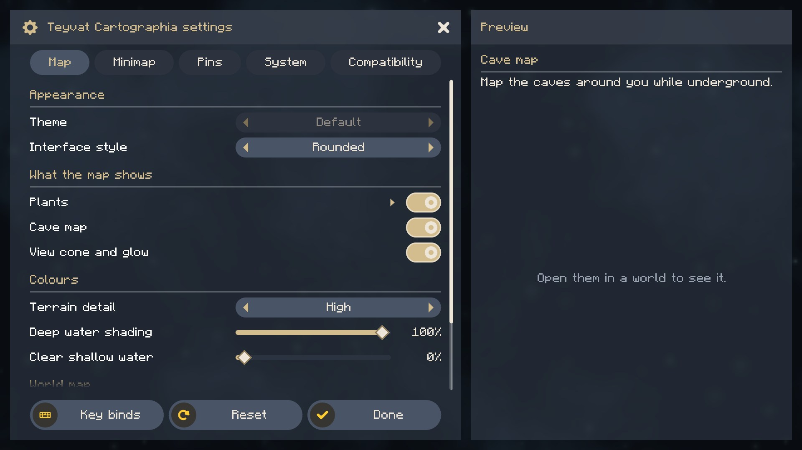
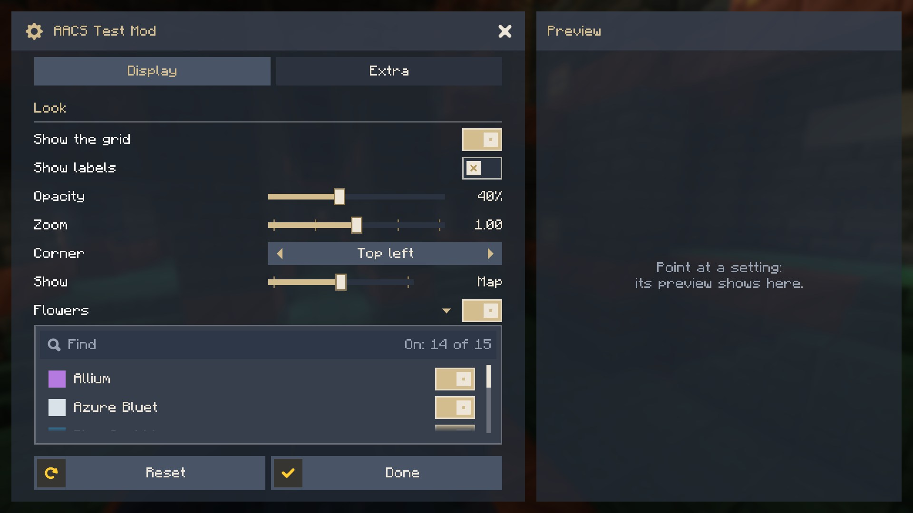
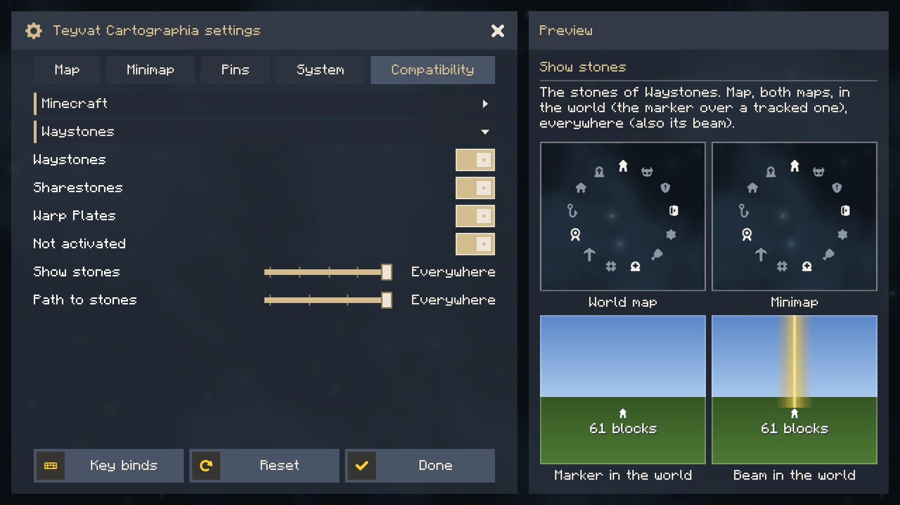
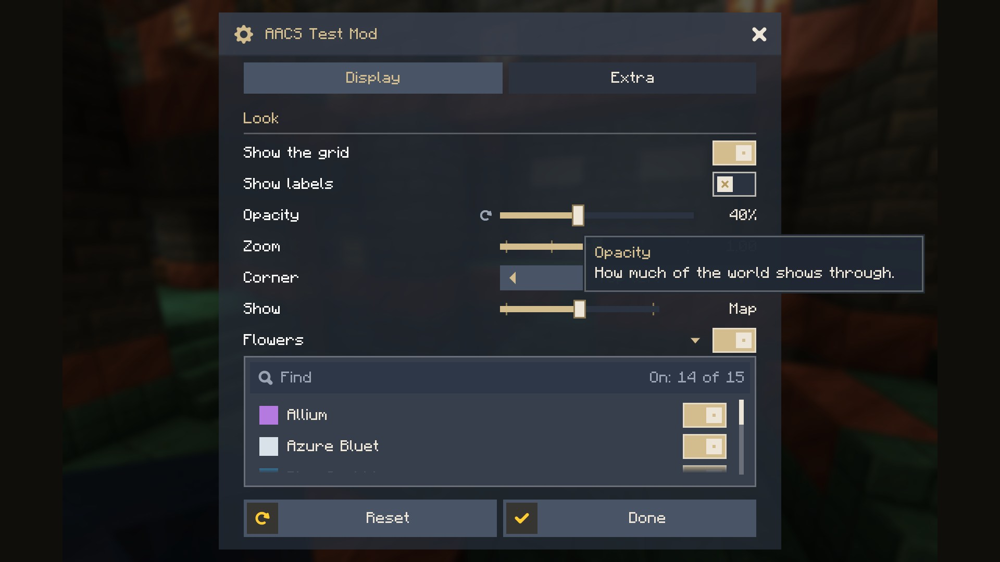

<p align="center">
  
</p>

<p align="center">
  <a href="https://modrinth.com/mod/actually-amazing-config-screen"></a>
  <a href="https://www.curseforge.com/minecraft/mc-mods/actually-amazing-config-screen"></a>
  <a href="https://github.com/Tapacywka/actually-amazing-config-screen/releases"></a>
  
  <a href="https://github.com/Tapacywka/actually-amazing-config-screen/blob/main/LICENSE"></a>
</p>

<p align="center">
  <b>A settings screen for your Fabric or NeoForge mod that players actually enjoy using.</b><br>
  Describe your settings once and get tabs, smooth scrolling and a card that shows what each setting does.
</p>

<p align="center">
  <a href="https://modrinth.com/mod/actually-amazing-config-screen"></a>
  <a href="https://www.curseforge.com/minecraft/mc-mods/actually-amazing-config-screen"></a>
  <a href="https://github.com/Tapacywka/actually-amazing-config-screen/releases"></a>
</p>

<p align="center">
  
</p>

<h2 id="features">✨ Features</h2>

- **Tabs and sections**: tabs as wide as their titles (they scroll when there are many), sub-sections that fold.
- **A preview card**: point at a setting and see its name, description and a picture of what it changes. In a narrow window the description becomes a tooltip.
- **Every kind of row**: switches, sliders with units or steps, choices with arrows, check boxes for the parts of one setting, a switch with a searchable list, a button that opens your own window.
- **Smooth everything**: scrolling without steps, rows that fade at the edges, a reset icon beside every changed setting.
- **Your look**: rectangular or rounded, your colours and background, kept at a readable size on any screen.
- **Room for others**: a tab where other mods can add their own settings.
- **Settings button** in Mod Menu and in NeoForge's mod list, set up for you.

<p align="center">
  
  
  
  
</p>

<h2 id="installation">📥 Installation</h2>

| Minecraft | Loader | You also need |
|---|---|---|
| 1.21.1, 26.1.2, 26.2, 26.3 | [Fabric](https://github.com/FabricMC/fabric-loader) | nothing (no Fabric API) |
| 1.21.1, 26.1.2, 26.2, 26.3 | [NeoForge](https://github.com/neoforged/NeoForge) | nothing |

Install it with the mods that ask for it, such as [Teyvat Cartographia](https://github.com/Tapacywka/teyvat-cartographia): put the file for your game and loader into `mods/` (Prism Launcher, the Modrinth App and the CurseForge App offer it with such a mod by themselves). A mod may also bring it inside its own file; then you install nothing. It is client-side only.

<h2 id="connector">🔌 Sinytra Connector</h2>

On NeoForge, take the NeoForge file. The Fabric file runs there too, through [Sinytra Connector](https://github.com/Sinytra/Connector) with [Forgified Fabric API](https://github.com/Sinytra/ForgifiedFabricAPI) (checked with Teyvat Cartographia on 1.21.1, 26.1.2 and 26.2); [Connector Extras](https://github.com/Sinytra/ConnectorExtras) adds the settings button to NeoForge's mod list.

<h2 id="authors">🛠️ For mod authors</h2>

Embed it in your JAR, so your players have nothing to install. It is on [Modrinth Maven](https://support.modrinth.com/en/articles/8801191-modrinth-maven):

```groovy
repositories { maven { url = 'https://api.modrinth.com/maven' } }

dependencies {
    // Fabric (on 26.x: implementation instead of modImplementation)
    include(modImplementation('maven.modrinth:actually-amazing-config-screen:1.4.1+mc1.21.1-fabric'))
    // NeoForge
    jarJar(implementation('maven.modrinth:actually-amazing-config-screen:1.4.1+mc1.21.1-neoforge'))
}
```

Or leave out `include` and `jarJar` and ask for the mod `aacs` as a required dependency, as Teyvat Cartographia does since 1.4.0: your players install it beside your mod and get each newer version of it at once.

Describe the settings, then the screen:

```java
ConfigFile.Builder b = ConfigFile.builder();
BoolValue grid = b.bool("grid", true);
IntValue opacity = b.integer("opacity", 80, 0, 100);
ConfigFile file = b.build();
file.load(configDir.resolve("mymod-client.json"));

AacsScreen screen = AacsScreen.builder("mymod", file)
        .tab("mymod.config.tab.display", t -> t
                .toggle(grid)
                .slider(opacity, s -> s.unit("%")))
        .build();

Minecraft.getInstance().setScreen(screen.open(parent));
```

Names and descriptions come from your lang files (`mymod.config.<key>` and `mymod.config.<key>.tooltip`).

<h2 id="faq">❓ Questions</h2>

<details>
<summary><b>Why is it in my mod list if I never installed it?</b></summary>

A mod you play asks for it, or brought it inside its own file. That mod's settings button opens its screen.
</details>

<details>
<summary><b>Two of my mods carry different versions. Is that a problem?</b></summary>

No. The loader keeps the newest copy, and the API in `net.tapacywka.aacs.api` is stable since 1.0.0: it only grows, older calls keep working.
</details>

<h2 id="links">🔗 Links</h2>

- [Report a bug or suggest an idea](https://github.com/Tapacywka/actually-amazing-config-screen/issues/new/choose) (please attach `logs/latest.log`)
- [Changelog](https://github.com/Tapacywka/actually-amazing-config-screen/blob/main/CHANGELOG.md)
- [Source code](https://github.com/Tapacywka/actually-amazing-config-screen): `./gradlew build` (branch `main` for 1.21.1, `mc26` for 26.x); `./gradlew :fabric:runClient` opens a test mod with every kind of row

<sub>MIT License. Icons from Game Icon Pack by Nieobie (CC0). Made for [Teyvat Cartographia](https://github.com/Tapacywka/teyvat-cartographia), free for any mod.</sub>
